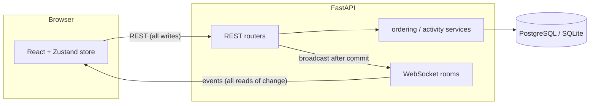

# Driftboard

A real-time collaborative kanban board. Open the same board in two browsers and drag a card, and the change appears in the other window, along with presence avatars and a live activity feed.

**Stack:** FastAPI · async SQLAlchemy 2.0 · WebSockets · PostgreSQL/SQLite · React 18 · TypeScript (strict) · Zustand · Vite · Docker · GitHub Actions

## Features

- Multi-user live sync over WebSockets: card/column mutations, presence ("who's viewing"), and an activity feed fan out to everyone on the board in real time
- Drag & drop for cards and columns with optimistic UI — the move renders instantly and the server event confirms (or corrects) it
- JWT auth, bcrypt password hashing, and membership-based authorization — non-members get a 404, not a 403, so the API doesn't reveal which boards exist
- Board sharing: owners invite members by email; owner-only invite/delete enforced server-side
- Card labels and descriptions, inline rename for boards and columns, connection-status indicator, automatic WebSocket reconnect with exponential backoff and state reconciliation
- 27 backend tests covering auth, permissions, ordering edge cases, and WebSocket event fan-out

## Architecture



The core design decision: **all mutations go through REST; WebSockets are a one-way event fan-out** (plus heartbeats). Writes get normal HTTP semantics — status codes, validation errors, auth middleware — while every connected client, including the author, receives the committed result as an event. Events are broadcast only *after* the transaction commits, so clients never see rolled-back state. Card and column events carry the server's values, which overwrite the client's copy: server state is truth, optimistic state is a preview.

### Real-time protocol

Connect to `/ws/boards/{id}?token=<jwt>`. The server validates the token and board membership before joining the room (closing with app codes `4401`/`4403` otherwise). Every message has the shape `{type, data, actor_id, ts}`:

| Type | Payload |
|---|---|
| `presence` | current viewers of the board |
| `column.created/updated/moved/deleted` | column payload; `moved` includes rebalanced positions when applicable |
| `card.created/updated/moved/deleted` | card payload; `moved` includes the source column and any rebalance |
| `board.updated/deleted`, `member.added` | board metadata changes |
| `activity.created` | human-readable audit entry |

### Ordering: fractional positions

Cards and columns carry a float `position`; inserting between neighbours takes the midpoint, so any drag writes exactly **one row** — no `position = position + 1` cascades. Clients send *neighbour IDs* (`before_id`/`after_id`), never raw positions, and the server computes the value; that keeps clients unable to corrupt ordering and makes concurrent moves converge. Repeated midpoint insertion eventually exhausts float precision, so the server detects the underflow, rebalances the column to even spacing in one pass, and includes the new positions in the broadcast event. There's a test that squeezes 60 head-insertions into a column to check that the rebalance fires and ordering survives.

## Run it

### Docker (Postgres)

```bash
docker compose up --build
```

Frontend at http://localhost:8080, interactive API docs at http://localhost:8000/docs.

### Local dev (SQLite, hot reload)

```bash
# terminal 1 — API on :8000
cd server
pip install -r requirements-dev.txt
python -m app.seed          # optional demo data
uvicorn app.main:app --reload

# terminal 2 — web on :5173 (proxies /api and /ws to :8000)
cd web
npm install
npm run dev
```

Seeded demo logins (local accounts created by the seed script): `Jad.Salem.Official@gmail.com` / `demopassword` and `maya@example.com` / `demopassword` — open the same board in a normal and an incognito window to see live sync.

### Tests

```bash
cd server && pytest        # 27 tests: REST, permissions, ordering, WebSockets
cd web && npm run build    # strict TypeScript compile + production build
```

GitHub Actions runs both on every push and pull request (`.github/workflows/ci.yml`).

## API overview

| Method & path | Purpose |
|---|---|
| `POST /api/auth/register` · `login` · `GET /api/auth/me` | JWT auth |
| `GET/POST /api/boards` · `GET/PATCH/DELETE /api/boards/{id}` | boards |
| `POST /api/boards/{id}/members` · `GET /api/boards/{id}/activity` | sharing, audit feed |
| `POST /api/boards/{id}/columns` · `PATCH/DELETE /api/columns/{id}` · `POST /api/columns/{id}/move` | columns |
| `POST /api/columns/{id}/cards` · `PATCH/DELETE /api/cards/{id}` · `POST /api/cards/{id}/move` | cards |
| `WS /ws/boards/{id}` | live events + presence |

## Project structure

```
server/
  app/
    main.py          # app factory, lifespan, WebSocket endpoint
    models.py        # SQLAlchemy 2.0 typed models
    schemas.py       # Pydantic request/response models
    deps.py          # auth + session + membership dependencies
    ws.py            # ConnectionManager (rooms, presence, broadcast)
    routers/         # auth, boards, columns, cards
    services/        # fractional ordering, activity recording
    seed.py          # demo data
  tests/             # pytest suite (TestClient, incl. WebSocket tests)
web/
  src/
    store/           # Zustand: auth + normalized board state, event application
    ws/socket.ts     # reconnecting WebSocket client (backoff, heartbeat)
    components/      # board, columns, DnD cards, modal, presence, activity
```

## Design notes & scaling

- **Async end to end.** SQLAlchemy async engine (aiosqlite locally, asyncpg in Docker); the same codebase runs on either via one env var.
- **App factory + state, no globals.** Settings, sessionmaker, and the WebSocket manager live on `app.state`, so tests spin up isolated apps with temp databases — no monkeypatching.
- **Reconnect correctness.** After a dropped connection the client refetches the whole board on reconnect rather than trying to replay missed events. That's simpler, at the cost of a small window where an event arriving mid-fetch can be overwritten by the slightly older snapshot until that item changes again.
- **Horizontal scaling.** The `ConnectionManager` is in-process; the seam to make fan-out multi-instance is swapping its `broadcast` for Redis pub/sub, with sticky or shared-nothing WS nodes. Migrations would move from `create_all` to Alembic before any schema evolution.
- **Known trade-offs.** JWT in `localStorage` (vs. httpOnly cookie + CSRF) keeps the demo self-contained; rate limiting and refresh tokens are the next auth hardening steps.

## License

MIT
